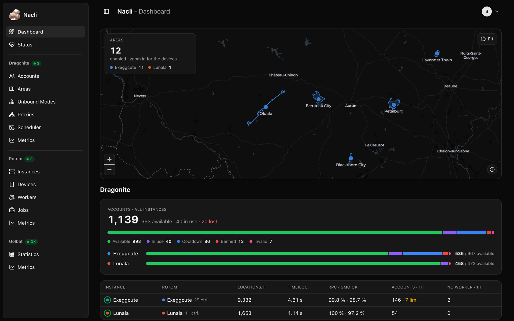
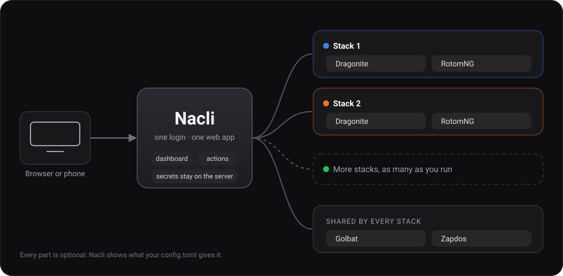
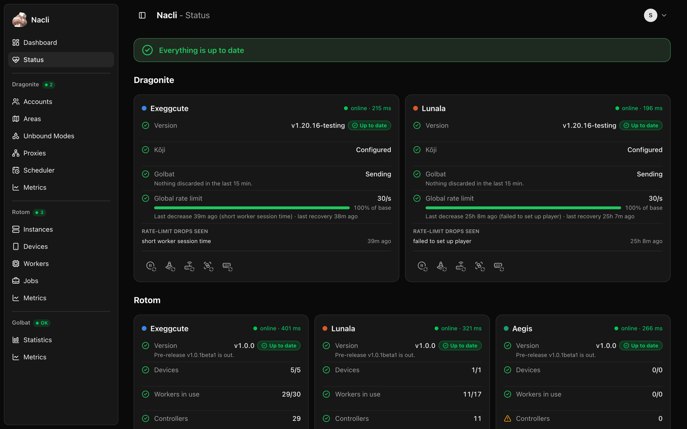
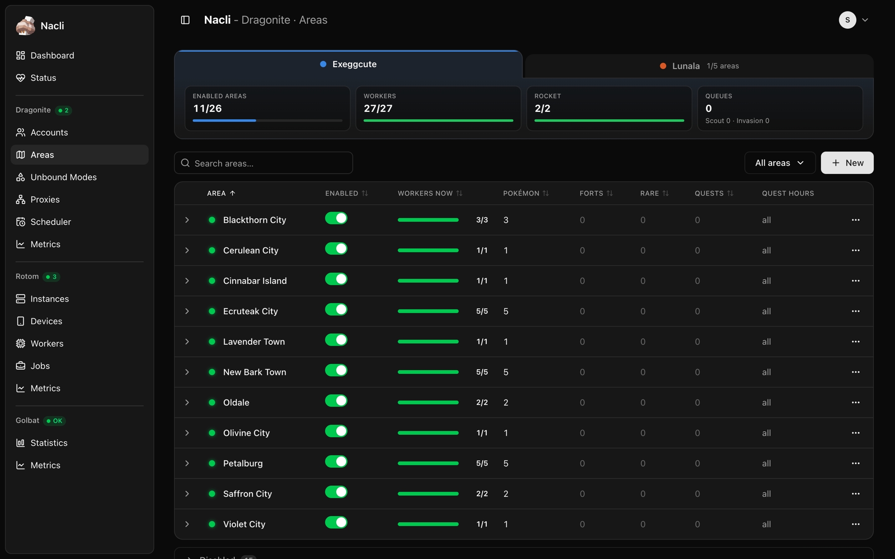
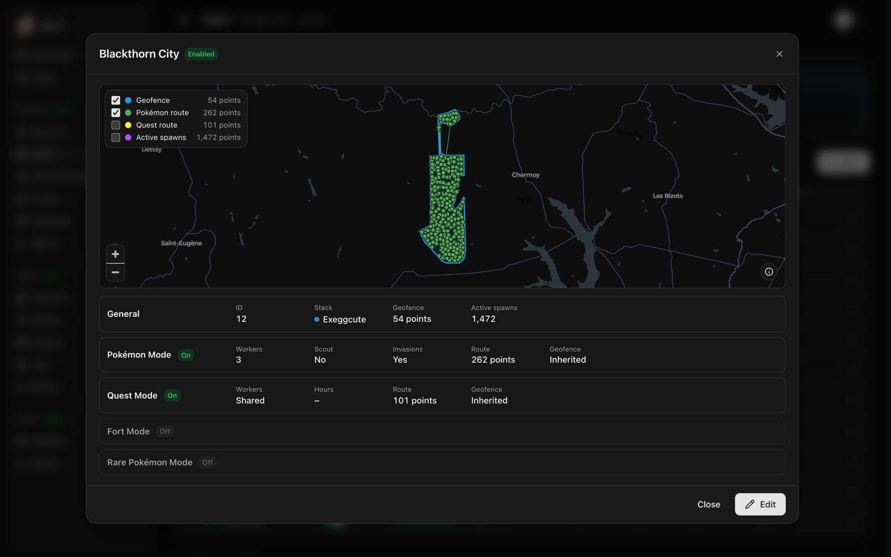
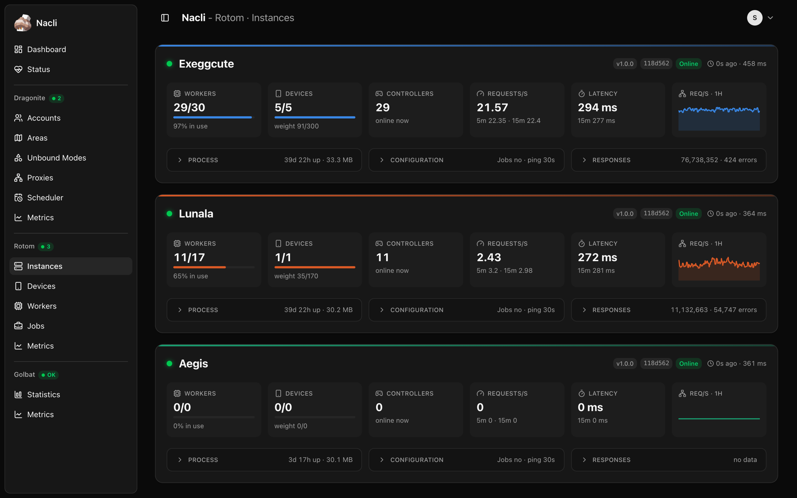
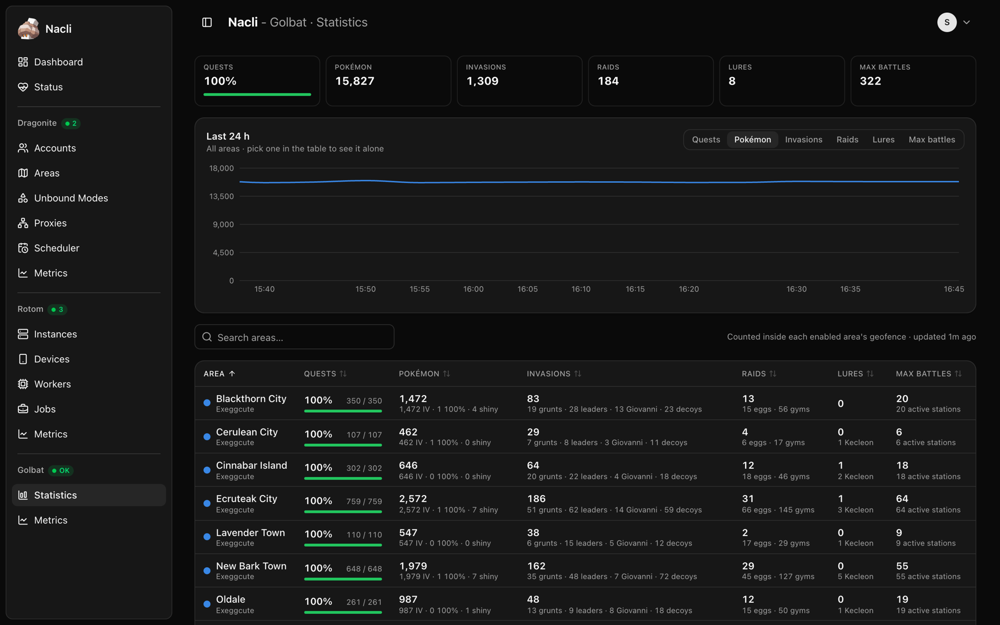
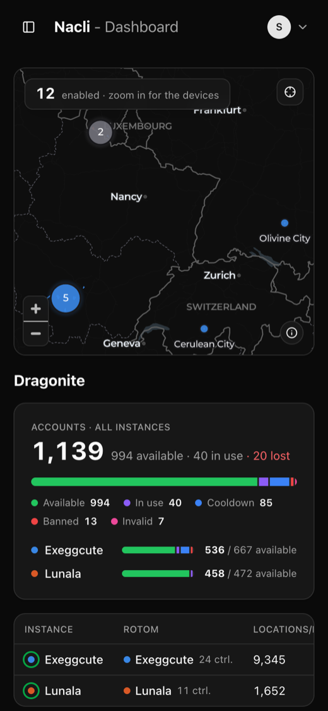
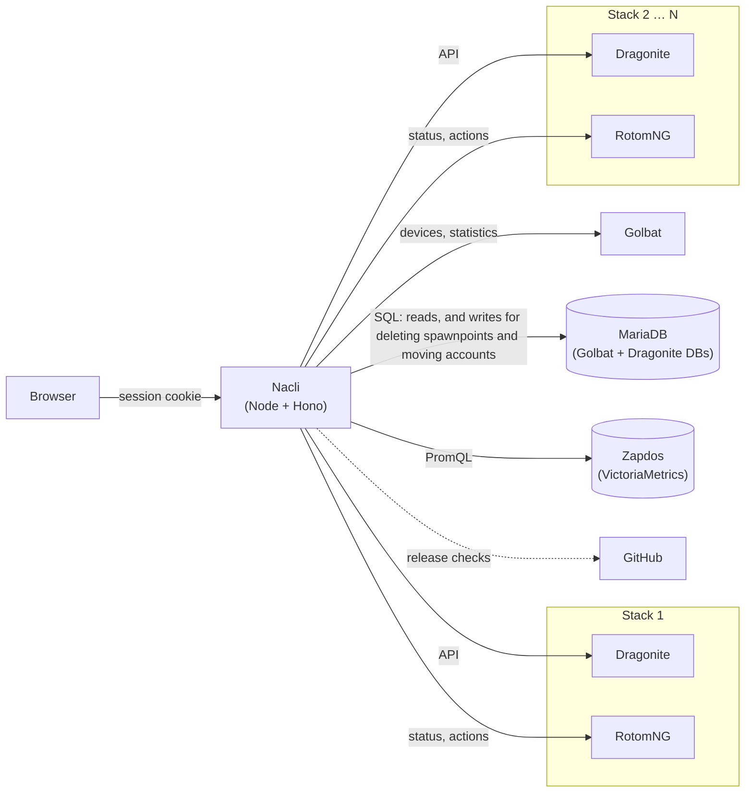

<div align="center">


# Nacli

**A manager for the whole UnownHash stack: Dragonite, RotomNG, Golbat and Zapdos.**

Run as many Dragonite + RotomNG pairs as you like and manage all of them from one place:
areas, accounts, proxies, modes, schedules, devices and their status, side by side.

[](https://github.com/prof-miles0/nacli/actions/workflows/docker.yml)
[](https://github.com/prof-miles0/nacli/pkgs/container/nacli)


</div>

---

<p align="center">
  
</p>

## What is Nacli?

[UnownHash](https://github.com/UnownHash) is made of several projects, each with its own
admin or API: [Dragonite](https://github.com/UnownHash/Dragonite-Public) (the scanner),
[RotomNG](https://github.com/UnownHash/RotomNG) (the devices),
[Golbat](https://github.com/UnownHash/Golbat) (the data) and
[Zapdos](https://github.com/UnownHash/Zapdos) (the metrics). Run more than one scanner and you
also get more than one Dragonite and RotomNG to keep an eye on.

Nacli puts all of it behind **one web app with its own login**. Each **stack** is a Dragonite
and the RotomNG it uses; add as many as you run, and Golbat and Zapdos are shared by all of
them. Lists span every stack at once, each stack keeps its colour everywhere, and areas,
modes, schedules and proxies can be copied from one stack to another.

<p align="center">
  
</p>

**Nothing is required.** Every part is optional, and Nacli shows the pages that what you give
it allows: a single RotomNG, a Dragonite on its own, or the whole stack. Secrets never leave
the server; the browser only ever talks to Nacli.

## ✨ Features

### 🗺️ Dashboard

- **One map for every stack**: the areas of every Dragonite, grouped when they are close,
  and, with Golbat, the devices as you zoom in, with the trail of each controller.
- Accounts, Dragonite and Rotom overviews, with charts of workers and throughput.

### 🩺 Status

- Whether every **Dragonite**, **RotomNG**, **Golbat** and **Zapdos** answers, and whether
  Dragonite and RotomNG are **up to date** with their GitHub releases.
- Kōji, Golbat and the global rate limit per Dragonite, with the admin's controls (pause
  or reset the limit, reload proxies, accounts or Dragonite).
- An **alerts bar on every page** for anything that needs attention.

<p align="center">
  
</p>

### 🐉 Dragonite

| Page | What you can do |
|---|---|
| **Accounts** | Totals per stack and state, by level, and one searchable list across every stack, filtered by state. Add one account or import a CSV. Move accounts to another stack: tick them, or pick how many available ones; their rows go from one Dragonite database to the other and both Dragonites reload their accounts (needs a `database` in both, and the grants below). |
| **Areas** | Every area with its live workers. Create, view and edit them (with a map, routes from [Kōji](https://github.com/TurtIeSocks/Koji), every mode), enable or disable them, start or stop quests, and copy or move them between stacks. |
| **Unbound Modes** | Level, Invasion and Scout modes: create, edit, delete and copy them; scout jobs on a map and the scout queue. |
| **Proxies** | Every stack's proxies in one list: add one or import many, copy them to other stacks, enable, disable or delete them. |
| **Scheduler** | Schedules and groups, the run ledger, what is active now, and copying a schedule to another stack. |
| **Metrics** | Dragonite's charts, from Zapdos or from memory. |

<p align="center">
  
  
</p>

### 📱 Rotom

- **Instances**, **Devices**, **Workers**, **Jobs** and **Metrics** for every RotomNG at once.
- Device actions (restart, reboot, logcat…), controller actions and jobs.

### 🦇 Golbat

- **Statistics** per Dragonite area: quests, Pokémon, invasions, raids, lures and Max battles,
  with their last 24 h when `stats_poll_interval` is set.
- **Spawnpoints** from Golbat's database: every spawnpoint in each Dragonite area on a map,
  coloured by whether its despawn time is known or when it was last seen, or as a density map.
  The share of encounters with a verified despawn time and of Pokémon with IV, from Golbat's `pokemon_area_stats`:
  read every 5 minutes, as Blissey does, and kept 90 days in `state_file` (hourly after a
  week), for all of Golbat's areas, one of them or one of its fences. With it, Blissey's
  "Spawnpoint type" (30 or 60 min spawns, by the time left at the encounter) and the minutes
  left in each, as stacked bars.
  Its tools back up the whole spawnpoint table (a `.sql.gz` that restores the missing rows
  and leaves the rest), and delete spawnpoints by filter (an area, every area or outside
  them all; last seen over N days ago; despawn known or not), after a preview of how many
  match and typing that number to confirm.
- Golbat's charts, from Zapdos or from memory.

<p align="center">
  
  
</p>

### And also

- **Charts without Zapdos**: whatever Zapdos does not cover is kept in memory and saved to
  disk, so a restart keeps the last 24 h.
- **A database connection**: one MariaDB account for Golbat's database and each Dragonite's,
  granted only the tables and actions you use (reads, plus deleting spawnpoints and moving
  accounts), with a DB pill per part in the sidebar.
- **Help** in the user menu: how to connect every part of the stack, the database account's
  permissions, and what the running `config.toml` has connected.
- Light and dark themes, and a layout made for phones too.

<p align="center">
  
</p>

## 🚀 Quick start

Nacli is published as a Docker image for `linux/amd64` and `linux/arm64`.

1. Create `config/config.toml` from [`config.example.toml`](config.example.toml) (see
   *Configuration* below), and a `data` folder Nacli can write to (it runs as uid 1000):

   ```bash
   mkdir data && sudo chown 1000:1000 data
   ```

2. Run it:

```bash
docker run -d --name nacli -p 7080:7080 \
  -v $PWD/config:/app/config:ro \
  -v $PWD/data:/app/data \
  ghcr.io/prof-miles0/nacli:latest
```

3. Open <http://localhost:7080> and sign in with a user from `config.toml`.

Or with Docker Compose, starting from [`compose.example.yml`](compose.example.yml):

```bash
cp compose.example.yml compose.yml
docker compose up -d
```

| Tag | Points to |
|---|---|
| `latest`, `main` | The latest build of the `main` branch |
| `sha-<commit>` | That exact commit |
| `1.2.3`, `1.2` | A `v1.2.3` release tag |

> [!NOTE]
> **Edit `config.toml` without restarting.** With the `config` folder mounted, as above,
> Nacli picks up every save on its own: new stacks, users, URLs or secrets apply within a
> second, with no container restart. Only `listen` and `state_file` need one. Mount the
> **folder**, not the file alone: editors that save by replacing the file would leave the
> container reading the old one.

> [!TIP]
> Set a fixed `session_secret` so people stay signed in when the container restarts, and
> keep `listen = "0.0.0.0:7080"` (the default) so the container is reachable.

## ⚙️ Configuration

Everything lives in one `config.toml`. A minimal one, for a single stack:

```toml
[server]
session_secret = "a-long-random-string"

[map]                              # basemap for every map
style_url = "https://basemaps.cartocdn.com/gl/voyager-gl-style/style.json"
style_url_dark = "https://basemaps.cartocdn.com/gl/dark-matter-gl-style/style.json"
tiles_attribution = "&copy; OpenStreetMap &copy; CARTO"

[[users]]
username = "admin"
password = "change-this-password"

[[stack]]
name = "Alpha"

[stack.dragonite]
url = "http://10.0.0.10:7272"      # Dragonite's API (or its admin + "/api")

[stack.rotom]
url = "http://10.0.0.10:7072"      # RotomNG http_listener, without /api
api_secret = "..."                 # its http_listener.secret
```

<details>
<summary><b>Every section and option</b></summary>

#### `[server]`

| Key | Default | |
|---|---|---|
| `title` | `"Nacli"` | Name shown in the app. |
| `listen` | `"0.0.0.0:7080"` | Address and port to listen on. |
| `session_secret` | random | Signs session cookies. If empty, one is generated at startup and sessions are lost on restart. |
| `session_ttl` | `"24h"` | How long a sign-in lasts. |
| `secure_cookies` | `false` | Mark the cookie `Secure`; also on automatically behind a proxy sending `X-Forwarded-Proto: https`. |
| `poll_interval` | `"30s"` | How often the metrics of RotomNG, Dragonite and Golbat are read for the history in memory (only for those Zapdos does not cover). At least `"30s"`. |
| `request_timeout` | `"8s"` | Longest wait for any instance. |
| `history_retention` | `"24h"` | Chart history kept in memory, for every instance Zapdos does not cover. |
| `state_file` | `"data/state.json.gz"` | Where the histories kept in memory (charts and Statistics) are saved on exit and every 5 minutes, and loaded at start. Relative to the working folder (`/app/data` in Docker). `""` keeps them in memory only. |

#### `[[users]]`

One block per person who can sign in: `username` and `password`.

#### `[[stack]]`

One block per deployment, with a `name` and its RotomNG, its Dragonite or both. Nacli checks
that a Dragonite's controllers reach the Rotom of its own stack by the name each Dragonite
reports (with its `url`), so the stack's `name` can be anything.

- **`[stack.rotom]`** (optional): `url` (root of the `http_listener`, **without** `/api`), `api_secret`
  and, optionally, `zapdos_instance`, `headers` and
  `basic_auth = { username = "...", password = "..." }` for a proxy in front.
- **`[stack.dragonite]`** (optional): `url` of its API, either Dragonite's own
  (`http://host:7272`) or its admin plus `/api`; and optionally `zapdos_instance`, `api_secret`
  (sent as `X-Dragonite-Admin-Secret`), `headers` and `basic_auth`. With a `url`, the
  Accounts, Areas, Unbound Modes, Proxies, Scheduler and Status pages are enabled, and the
  controls act on that Dragonite. `database` (optional, needs `[database]`) names its
  database on that server, used to move accounts between stacks; a DB pill next to Dragonite
  in the sidebar shows whether each one can be read. RotomNG has no database.

`zapdos_instance` is each instance's `instance` label in Zapdos, and it only counts
with `[zapdos]` (see below).

#### `[map]`

The basemap for **every map in Nacli**: the Dashboard (devices, geofences and trails) and
Unbound Modes (scout jobs). Configure it: without it the maps only draw their points on a
plain background, with no streets. `style_url` (vector, MapLibre GL) and optionally
`style_url_dark`, or `tiles_url` (raster); `carto_key` is appended as `api_key` to CARTO
URLs, and `tiles_attribution` is shown on the map. The browser loads tiles directly, so use
public URLs and a client key. The example uses CARTO's Voyager and Dark Matter styles.

#### `[golbat]` (optional)

- `url` and `api_secret`: Golbat's API. Enables the devices on the Dashboard map (with their
  trails), Golbat's state on Status, and the Golbat Metrics page from memory.
- `zapdos_instance` (optional): its `instance` label in Zapdos, for the Metrics page to
  draw the stored data.
- `stats_poll_interval` (optional, needs `url`): how often the Statistics figures are taken
  to chart their last 24 h (kept in memory). Empty or missing: no history. At least `"5m"`.
- `database` (optional, needs `[database]`): the name of Golbat's database on that server.
  Enables the Spawnpoints and Encounters pages, and a DB pill next to Golbat in the sidebar.

#### `[database]` (optional)

The MariaDB server of the stack: `host`, `port` (default 3306), `username` and `password`.
Each part names its own database on it: `database` in `[golbat]` and in each
`[stack.dragonite]`. Its address and password never reach the browser.

To connect it:

1. Make MariaDB reachable from Nacli: its `bind-address` must not be only `127.0.0.1` when
   Nacli runs on another host or in Docker, and port 3306 must be open from Nacli's host.
2. Give Nacli an account of its own (not Golbat's or Dragonite's). Nacli **reads and
   writes** in these databases, but only touches three tables, so grant table by table and
   only for the features you use:

   | Database | Table | Grant | For | Without it |
   |---|---|---|---|---|
   | Golbat | `spawnpoint` | `SELECT` | Spawnpoints page, spawnpoint backup, DB pill | No Spawnpoints page; the pill turns orange |
   | Golbat | `pokemon_area_stats` | `SELECT` | Encounters page | No Encounters history |
   | Golbat | `spawnpoint` | `DELETE` | Deleting spawnpoints (Spawnpoints › Delete) | The delete tool refuses |
   | Each Dragonite | `account` | `SELECT` | DB pill, moving accounts | The pill turns orange |
   | Each Dragonite | `account` | `INSERT`, `DELETE` | Moving accounts between stacks (Accounts › Move) | Moving refuses, nothing changes |

   For example, with everything (leave out the lines you don't need):

   ```sql
   CREATE USER 'nacli'@'%' IDENTIFIED BY 'a-long-random-password';  -- or 'nacli'@'<Nacli's IP>'

   -- Golbat
   GRANT SELECT ON golbat.spawnpoint TO 'nacli'@'%';
   GRANT SELECT ON golbat.pokemon_area_stats TO 'nacli'@'%';
   GRANT DELETE ON golbat.spawnpoint TO 'nacli'@'%';                    -- deleting spawnpoints

   -- Each Dragonite with a database
   GRANT SELECT ON dragonite_alpha.account TO 'nacli'@'%';
   GRANT INSERT, DELETE ON dragonite_alpha.account TO 'nacli'@'%';      -- moving accounts
   ```

   Nacli never creates, alters or drops tables, and never writes to any other table. Moving
   accounts copies each row to the other Dragonite's `account` table and deletes it from the
   first in one transaction, so a failure leaves both as they were.
3. Add `[database]` and the `database` names to `config.toml` and save. The DB pills in the
   sidebar turn green; orange when the server answers but a database or table is not granted
   (or missing), red when it cannot be reached. Hover for the reason, click for the Help step.

The **Help** page (user menu, top right) walks through connecting every part of the stack,
with these permissions, and lists what the running `config.toml` has connected.

#### `[zapdos]` (optional)

[Zapdos](https://github.com/UnownHash/Zapdos) is UnownHash's metrics stack: vmagent scrapes
RotomNG, Dragonite and Golbat into VictoriaMetrics, with Grafana on top. Point `url` at its
VictoriaMetrics (port 8428) and the charts come from there, up to 30 days. Also
`username`/`password` or `bearer_token`, `instance_label` (default `instance`) and an
optional `selector` added to every query.

For every instance Zapdos does not cover, Nacli keeps the last `history_retention`
(24 h) in memory, by reading its metrics every `poll_interval`: RotomNG's `/api/metrics`, and
Dragonite's and Golbat's `/metrics` (Dragonite's needs its own `url`, not the admin's). An instance's charts come from Zapdos when its `zapdos_instance` has any data
there in the last 30 days; **without `[zapdos]`, without a `zapdos_instance`, or with one that has no data,
they come from memory**. Nacli checks at startup, whenever `config.toml` changes and every
5 minutes; when an instance in Zapdos has sent nothing for 30 minutes, its charts stay on Zapdos
and a warning asks to check that Zapdos still scrapes it. The memory history and the
Statistics one are saved to `state_file` on exit and every 5 minutes, and loaded at start, so
a restart keeps the charts. Rotom's charts can mix both.

</details>

See [`config.example.toml`](config.example.toml) for a commented example of everything.

## 🛠️ Running from source

Requires Node.js 24 or newer (`.nvmrc` pins it for nvm).

```bash
cp config.example.toml config.toml   # then edit it
npm install
npm run build
npm start                            # http://localhost:7080
```

For development, with hot reload (frontend on `:5173`, API on `:7080`):

```bash
npm run dev
```

`npm run typecheck` checks the whole project. To build the image yourself:
`docker build -t nacli .`

## 🧩 How it works



- The **server** (`server/`, Node + [Hono](https://hono.dev)) talks to each RotomNG and
  Dragonite API on demand, when a page needs it (RotomNG's answers are shared for 3 s), and
  asks Zapdos for the charts. Only for the instances Zapdos does not cover
  does it read their metrics regularly, to keep the last 24 h in memory (saved to
  `state_file` on exit and every 5 minutes, so a restart keeps them).
- The **web app** (`web/`, React + Vite + Tailwind) only ever talks to Nacli's `/api`.
- `shared/` holds the types both sides use.

## 🔒 Security

- **Secrets stay on the server.** Instance secrets, account passwords and tokens, and proxy
  credentials never reach the browser.
- **Everything under `/api` needs a session**, except signing in and out. The session is an
  `HttpOnly`, `SameSite=Strict` cookie signed with `session_secret`.
- **Requests that change anything** also need an `X-Nacli` header, so another site cannot
  make them with your cookie.
- **Sign-in is rate-limited**: 10 failed attempts per 5 minutes per IP.
- **Rotom actions** go through an allowlist of operations; anything else is refused.
- Every change made through Nacli is **logged** with the user who made it.

## 📁 Project layout

```
server/        API server: config, auth, RotomNG, Dragonite, Golbat, Zapdos and MariaDB
shared/        Types shared by the server and the web app
web/           React app (pages, components, styles)
docs/          The README's diagram and screenshots
Dockerfile     Two-stage image: build on Debian, run on Alpine as a non-root user
.github/       Workflow that builds and publishes the image to ghcr.io
```

---

<div align="center">
<sub>Nacli is an independent project, not affiliated with UnownHash, Niantic or The Pokémon Company.</sub>
</div>
