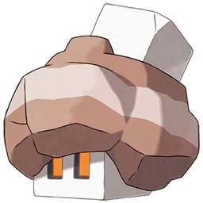
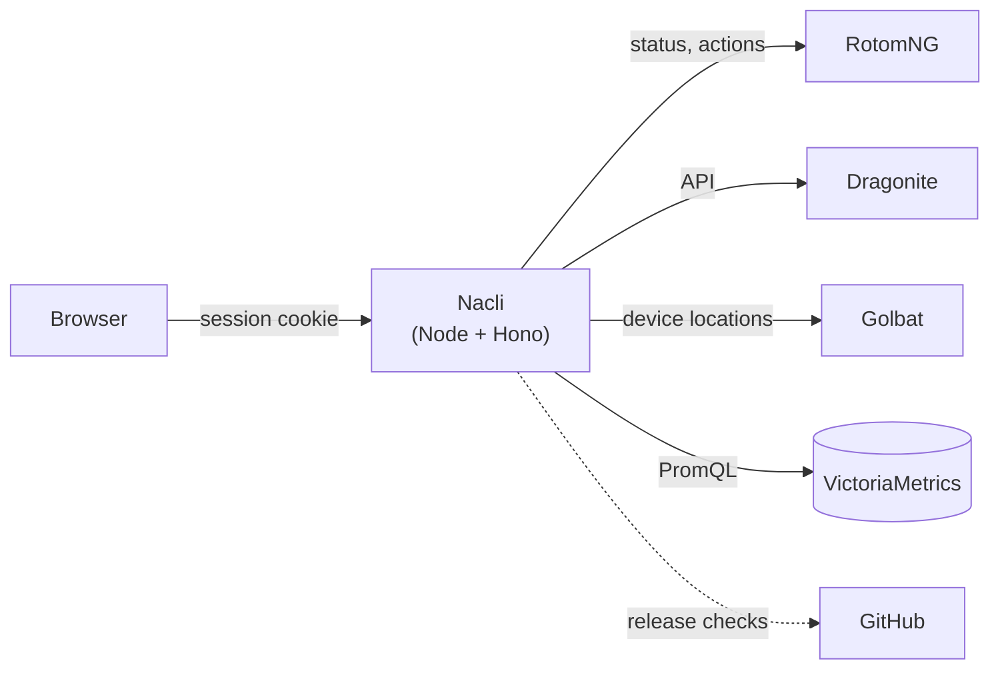

<div align="center">



# Nacli

**One dashboard for your Dragonite, RotomNG and Golbat stacks.**

See every stack at a glance, follow your devices on a map, and manage areas, accounts,
proxies, modes and schedules without jumping between admins.

[](https://github.com/prof-miles0/nacli/actions/workflows/docker.yml)
[](https://github.com/prof-miles0/nacli/pkgs/container/nacli)


</div>

---

Nacli sits in front of one or more **stacks** (a [RotomNG](https://github.com/UnownHash/RotomNG),
the [Dragonite](https://github.com/UnownHash/Dragonite-Public) that feeds it and, optionally, Golbat)
and brings them together in a single web app with its own login. It looks and feels like the
Dragonite admin, works the same on a phone, and keeps every secret on the server: the browser
only ever talks to Nacli.

## ✨ Features

### 🗺️ Dashboard

- **Live map** of every device, from Golbat's last known location, coloured by stack and
  matched to its Rotom device, Dragonite area, mode and controller.
- **Geofences** of every enabled area, drawn in its stack's colour. Hover to see its name;
  **click one to show the trails of all the controllers working it**.
- **Controller trails** for the last 30 minutes, followed per controller (they survive a move
  to another worker). Jumps of more than 50 km are dropped as bad readings, except for
  Invasion and Scout controllers, which really do travel far.
- Accounts, Dragonite and Rotom overviews, with charts of workers and throughput.

### 🩺 Status

- Per Dragonite: whether **Kōji** and **Golbat** are connected, its **global rate limit** and
  why it last dropped, and whether **Dragonite** and **RotomNG** are **up to date** with their
  latest GitHub releases (all green when they are).
- The Dragonite admin's controls, per instance: **pause or reset the global rate limit**,
  **reload proxies**, **reload accounts** and **reload Dragonite**.
- An **alerts bar on every page** for anything that needs attention: an instance offline, a
  degraded rate limit, controllers reaching the wrong Rotom, Rotom rejecting controllers,
  Golbat not reporting, or an account present in more than one stack.

### 🐉 Dragonite

| Page | What you can do |
|---|---|
| **Accounts** | Totals and states per stack, accounts by level, and searchable *In use* / *Available* lists across every stack. **Create** an account or **import** a CSV, as the admin does, choosing the one stack it belongs to. Warns when an account is in more than one stack. |
| **Areas** | Every area with its live workers. **Create** an area (same fields as the admin) in one or several stacks, with at most one of them enabled; **enable/disable**, **edit** workers and per-mode options, and **copy or move** areas between stacks. |
| **Unbound Modes** | Level, Invasion and Scout modes together: **create, edit, delete and copy** them. Scout jobs on a map, the scout queue (and clearing it), Invasion status charts, Level progress per account, and the areas that answer scout requests. |
| **Proxies** | Every stack's proxies in one list, counted once however many stacks share them. **Create** a proxy in one or all stacks, **import** a list, **copy** proxies (keeping their names) to other stacks, enable, disable or delete them. |
| **Scheduler** | Manage **schedules** and **groups**, read the **run ledger**, see what is active now and any diagnostics, **run** a schedule now, run the quest migration, and **copy a schedule** to another stack. |
| **Metrics** | Dragonite's charts, from VictoriaMetrics or from the last 24 h kept in memory. |

### 📱 Rotom

- **Instances**, **Devices**, **Workers**, **Jobs** and **Metrics** for every RotomNG at once.
- Device actions: restart the app, reboot, enable, disable, disconnect and **view its logcat**
  in place. Controller actions: request a reconnect or disconnect it. Run and clear jobs.

### 🦇 Golbat

- Golbat's Grafana charts, from VictoriaMetrics or from the last 24 h kept in memory.

### And also

- Light and dark themes, a layout that works on phones, and sections that only appear for
  what your `config.toml` actually configures.

## 🚀 Quick start

Nacli is published as a Docker image for `linux/amd64` and `linux/arm64`.

1. Create `config/config.toml` from [`config.example.toml`](config.example.toml) (see
   *Configuration* below).
2. Run it:

```bash
docker run -d --name nacli -p 7080:7080 \
  -v $PWD/config:/app/config:ro \
  ghcr.io/prof-miles0/nacli:latest
```

3. Open <http://localhost:7080> and sign in with a user from `config.toml`.

Or with Docker Compose, starting from [`compose.example.yml`](compose.example.yml):

```bash
cp compose.example.yml compose.yml
docker compose up -d
```

| Tag | Points to |
|---|---|
| `latest`, `main` | The latest build of the `main` branch |
| `sha-<commit>` | That exact commit |
| `1.2.3`, `1.2` | A `v1.2.3` release tag |

> [!TIP]
> Set a fixed `session_secret` so people stay signed in when the container restarts, and
> keep `listen = "0.0.0.0:7080"` (the default) so the container is reachable. Changes to
> `config.toml` are picked up on save, with no restart. Mount its **folder**, as above,
> not the file alone: editors that save by replacing the file would leave the container
> reading the old one.

## ⚙️ Configuration

Everything lives in one `config.toml`. A minimal one, for a single stack:

```toml
[server]
session_secret = "a-long-random-string"

[map]                              # basemap for every map
style_url = "https://basemaps.cartocdn.com/gl/voyager-gl-style/style.json"
style_url_dark = "https://basemaps.cartocdn.com/gl/dark-matter-gl-style/style.json"
tiles_attribution = "&copy; OpenStreetMap &copy; CARTO"

[[users]]
username = "admin"
password = "change-this-password"

[[stack]]
name = "Exeggcute"

[stack.rotom]
url = "http://10.0.0.10:7072"      # RotomNG http_listener, without /api
api_secret = "..."                 # its http_listener.secret
vm_instance = "rotom-ng"

[stack.dragonite]
url = "http://10.0.0.10:7272"      # Dragonite's API (or its admin + "/api")
vm_instance = "dragonite"
```

<details>
<summary><b>Every section and option</b></summary>

#### `[server]`

| Key | Default | |
|---|---|---|
| `title` | `"Nacli"` | Name shown in the app. |
| `listen` | `"0.0.0.0:7080"` | Address and port to listen on. |
| `session_secret` | random | Signs session cookies. If empty, one is generated at startup and sessions are lost on restart. |
| `session_ttl` | `"24h"` | How long a sign-in lasts. |
| `secure_cookies` | `false` | Mark the cookie `Secure`; also on automatically behind a proxy sending `X-Forwarded-Proto: https`. |
| `poll_interval` | `"10s"` | How often the metrics of RotomNG, Dragonite and Golbat are read for the history in memory (only for those VictoriaMetrics does not cover). |
| `request_timeout` | `"8s"` | Longest wait for any instance. |
| `history_retention` | `"24h"` | Chart history kept in memory, for every instance VictoriaMetrics does not cover. |

#### `[[users]]`

One block per person who can sign in: `username` and `password`.

#### `[[stack]]`

One block per deployment, with a `name`. If it has a Dragonite, the name must match the one in
its user agent (`Dragonite - <name>`): that is how Nacli checks its controllers reach the Rotom
of the same stack.

- **`[stack.rotom]`**: `url` (root of the `http_listener`, **without** `/api`), `api_secret`
  and, optionally, `vm_instance`, `headers` and
  `basic_auth = { username = "...", password = "..." }` for a proxy in front.
- **`[stack.dragonite]`** (optional): `url` of its API, either Dragonite's own
  (`http://host:7272`) or its admin plus `/api`; and optionally `vm_instance`, `api_secret`
  (sent as `X-Dragonite-Admin-Secret`), `headers` and `basic_auth`. With a `url`, the
  Accounts, Areas, Unbound Modes, Proxies, Scheduler and Status pages are enabled, and the
  controls act on that Dragonite.

`vm_instance` is each instance's `instance` label in VictoriaMetrics, and it only counts
with `[victoriametrics]` (see below).

#### `[map]`

The basemap for **every map in Nacli**: the Dashboard (devices, geofences and trails) and
Unbound Modes (scout jobs). Configure it: without it the maps only draw their points on a
plain background, with no streets. `style_url` (vector, MapLibre GL) and optionally
`style_url_dark`, or `tiles_url` (raster); `carto_key` is appended as `api_key` to CARTO
URLs, and `tiles_attribution` is shown on the map. The browser loads tiles directly, so use
public URLs and a client key. The example uses CARTO's Voyager and Dark Matter styles.

#### `[golbat]` (optional)

- `url` and `api_secret`: Golbat's API. Enables the devices on the Dashboard map (with their
  trails), Golbat's state on Status, and the Golbat Metrics page from memory.
- `vm_instance` (optional): its `instance` label in VictoriaMetrics, for the Metrics page to
  draw the stored data.

#### `[victoriametrics]` (optional)

Where the charts come from, up to 30 days: `url`, `username`/`password` or `bearer_token`,
`instance_label` (default `instance`) and an optional `selector` added to every query.

For every instance VictoriaMetrics does not cover, Nacli keeps the last `history_retention`
(24 h) in memory, by reading its metrics every `poll_interval`: RotomNG's `/api/metrics`, and
Dragonite's and Golbat's `/metrics` (Dragonite's needs its own `url`, not the admin's). An instance's charts come from VictoriaMetrics only when its `vm_instance` has data
there; **without `[victoriametrics]`, without a `vm_instance`, or with one that has no data,
they come from memory**. Nacli checks which ones have data at startup, whenever
`config.toml` changes and every 5 minutes; an instance whose data stops arriving starts its
memory history from that moment. Rotom's charts can mix both; a Dragonite chart that adds
several stacks together uses memory as soon as one of them does.

</details>

See [`config.example.toml`](config.example.toml) for a commented example of everything.

## 🛠️ Running from source

Requires Node.js 20.19 or newer.

```bash
cp config.example.toml config.toml   # then edit it
npm install
npm run build
npm start                            # http://localhost:7080
```

For development, with hot reload (frontend on `:5173`, API on `:7080`):

```bash
npm run dev
```

`npm run typecheck` checks the whole project. To build the image yourself:
`docker build -t nacli .`

## 🧩 How it works



- The **server** (`server/`, Node + [Hono](https://hono.dev)) talks to each RotomNG and
  Dragonite API on demand, when a page needs it (RotomNG's answers are shared for 3 s), and
  asks VictoriaMetrics for the charts. Only for the instances VictoriaMetrics does not cover
  does it read their metrics regularly, to keep the last 24 h in memory.
- The **web app** (`web/`, React + Vite + Tailwind) only ever talks to Nacli's `/api`.
- `shared/` holds the types both sides use.

## 🔒 Security

- **Secrets stay on the server.** Instance secrets, account passwords and tokens, and proxy
  credentials never reach the browser.
- **Everything under `/api` needs a session**, except signing in and out. The session is an
  `HttpOnly`, `SameSite=Strict` cookie signed with `session_secret`.
- **Requests that change anything** also need an `X-Nacli` header, so another site cannot
  make them with your cookie.
- **Sign-in is rate-limited**: 10 failed attempts per 5 minutes per IP.
- **Rotom actions** go through an allowlist of operations; anything else is refused.
- Every change made through Nacli is **logged** with the user who made it.

## 📁 Project layout

```
server/        API server: config, auth, RotomNG, Dragonite, Golbat and VictoriaMetrics
shared/        Types shared by the server and the web app
web/           React app (pages, components, styles)
Dockerfile     Two-stage image: build on Debian, run on Alpine as a non-root user
.github/       Workflow that builds and publishes the image to ghcr.io
```

---

<div align="center">
<sub>Nacli is an independent project, not affiliated with UnownHash, Niantic or The Pokémon Company.</sub>
</div>
